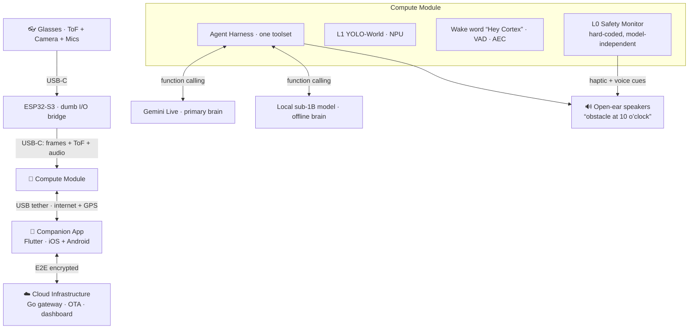

<div align="center">
  

  <br/>

  
  
  
  
  
  

  <br/>
  <br/>

  **From your front door to the hawker centre — completely on your own.**
  *Cane-aware safety · conversational AI · indoor navigation · built with the visually impaired community*
</div>

---

## 🌟 The Problem

> Visually impaired users are forced to choose between their **white cane** (safety) and a **smartphone** (navigation). Both hands, two tools, constant trade-off — and neither tool can read a sign, call out a bus number, or guide you through a shopping mall.

**Asirive Cortex** removes that trade-off: a pair of minimal custom glasses, a pocket compute module, and a companion app — with an AI brain that talks to you, keeps you safe, and knows the difference between what the cane already handles and what it can't.

---

## 🚶 The Journey

The product exists for one journey: **door-to-door, independently.**

> House → walk to the bus stop → *“Bus 161 arriving in 3 minutes”* → ride → *“Next stop: Bukit Panjang, 2 stops”* → MRT → walk into the mall → *“Escalator ahead, slightly left”* → *“Your table is the third one on the right.”*

Outdoor walking. Indoor spaces. Trains. Buses. Sign-heavy environments where GPS dies and spatial understanding is everything. **That** is what "independent navigation" means, and every architecture decision below serves it.

---

## 🧠 The 5-Layer Hybrid Brain

Cortex runs an edge-first, cloud-augmented architecture. Safety-critical layers stay on-device; deep scene understanding goes to the cloud — and the device never becomes useless without internet.

| Layer | Name | Role | Where |
|:---:|:---|:---|:---:|
| **L0** | **Guardian** | Safety-critical hazard detection + haptic | On-device, offline, **<100ms** |
| **L1** | **Learner** | Open-vocabulary detection (YOLO-World on NPU) | On-device |
| **L2** | **Thinker** | Scene understanding, conversation, agent function calling | Gemini Live (cloud) **+ local sub-1B model (offline)** |
| **L3** | **Guide** | Intent routing, navigation, transit, indoor guidance | On-device + phone relay |
| **L4** | **Memory** | Recall, conversation history, telemetry | Local-first, retention-aware sync |



**Dual brain, one toolset:** the same agent tools (navigate, bus-arrivals, describe-scene, camera-snap…) are callable by Gemini Live *or* by the local model via function calling. Connected → Gemini leads (indoor malls, bus interchanges, signs). Offline → local model keeps you moving.

---

## 🛡️ The Core Insight: Cane-Aware Safety

The white cane already covers the ground. Cortex does **not** duplicate it — it speaks up only for what the cane cannot perceive:

| Hazard | Cane covers it? | AI alerts? |
|:---|:---:|:---:|
| Walls, benches, curbs, steps **down** | ✅ | ❌ indoors |
| **Overhead** obstacles (signs, branches, low ceilings) | ❌ | ✅ |
| **Stairs going up** | ❌ | ✅ |
| **Fast-approaching** objects (vehicles, runners, e-scooters) | ❌ | ✅ |
| Visual information (signs, bus numbers, prices, faces) | ❌ | ✅ |

- **Tier 0** — cane-invisible trap → haptic + voice, always
- **Tier 1–3** — environmental / static / fast-approaching → voice cues with anti-spam cooldowns
- Safety alerts are **hard-coded and model-independent** — no AI sits between a hazard and its warning, and they work with no phone, no cloud, no internet.

---

## 🎤 Voice & Audio — the primary UX

- **Glasses-integrated audio:** 2× PDM MEMS mics + open-ear speakers (ears stay open for traffic).
- **Wake word “Hey Cortex”** on the compute module — plus a hands-free privacy story: *“I’m going to the door”* mutes the mic (confirmed by **haptic**), and the wake word brings it back.
- **Two voices:** *Katie* for conversation, *Troy* for safety — different gender = instantly distinguishable in the split second before you've parsed any words.
- **Cloud voices when connected** (Cartesia — fast), **Supertonic local TTS** offline. Whisper-class local STT as the offline floor.
- **Barge-in** — speak over Cortex and it stops talking. Echo cancellation is mandatory (open-ear speakers beside the bridge mics).

---

## 🗺️ Navigation & the Agent Harness

| Mode | Trigger | Behavior |
|:---|:---|:---|
| **IDLE** | Default | Silent unless a hazard fires |
| **OUTDOOR_NAV** | GPS fix + active route | Turn-by-turn, reads landmarks & signs at turns |
| **INDOOR_NAV** | GPS lost | Visual guidance — “door left”, “escalator ahead” |
| **BUS_STOP** | Near a stop | LTA DataMall arrivals + on-device bus-number reading |
| **TRANSIT** | On bus/MRT | Stop counting, overhead sign reading |

14+ agent functions: `search_places`, `get_directions`, `guide_indoor`, `get_bus_arrival`, `zoom_in`, `search_memory`, `report_obstacle`, … Multi-leg routes (Walk → Bus → MRT → Walk). Saved locations as default origin.

---

## 👓 Hardware — V4

### The glasses (~S$59 sensor BOM)
| Part | Role |
|:---|:---|
| **VL53L7CX** 8×8 ToF (64 zones, 90° FoV, 3.5 m), nose bridge | Overhead + ground hazards |
| **OV5640** 5 MP 120° **autofocus** camera, 78 mm brow ribbon | Scene stream + close-up reading (signs, prices) |
| **ESP32-S3** N16R8, temple arm | Dumb I/O bridge: camera + ToF + audio over one USB-C |
| 2× **MP34DT01** PDM MEMS mics | Voice + ambient capture |
| **MAX98357A** I2S amp + 2× **1511** open-ear speakers | Voice cues, hearing stays open |
| Haptic motor | Mic state + device status |

Design rules: **no-fold frame**, all sensors on the brow/bridge line, and the lower visual field **always clear** — partially-sighted users keep their remaining sight.

### The compute module
- **Alpha:** Radxa **Dragon Q8B** — Snapdragon 8cx Gen 3, 29+ TOPS AI Engine, 8 GB RAM, own battery (pogo-pin charging dock).
- **V4-Final:** custom SoM + custom carrier board — smaller, more powerful, production-ready.
- The phone is **data only** (USB-C tether: internet + GPS). It never powers the device.

---

## 📱 The Companion App

One Flutter app (iOS-first, Android in mind), two modes:

- **User mode** — pair the device (QR or USB claim), settings, beta opt-in, feedback, and **per-companion permission grants** for exactly who you choose — friends, family, certified medical professionals.
- **Companion mode** — see the user's **location** (30-day TTL) and make a **voice call**, WhatsApp-style. Never a live camera feed. Never stored photos or video.

---

## ☁️ Infrastructure — the control plane

- **Go fleet gateway** — device registry, E2E encrypted channels, dev-only remote commands (alpha bench only — production devices are **never remotely breakable**).
- **OTA with update rings** — `ALPHA (dev team)` → `BETA (opt-in)` → `STABLE`, signed artifacts, staged rollout, rollback. Firmware updates cover the compute module **and** the glasses MCU, delivered through the app.
- **Web dashboard** — fleet view, update rings, feedback tab.
- **In-app feedback** in every ring (text + trimmed logs), mirrored to the dashboard.

### 🔐 Privacy by design
| Data | Policy |
|:---|:---|
| Images / video | **Never stored.** Zero retention — even on our own infrastructure. |
| Location | Retained 30 days, per-companion consent |
| Calls, transit data, activity logs | Stored |
| Companion access | Location + call only. No live feed. Ever. |

---

## 📊 By the Numbers (V3 measured)

| Metric | Value |
|:---|---:|
| Safety latency (on-device) | **< 100 ms** (80.7 ms avg measured) |
| Intent routing accuracy | **97.7%** (14 intents) |
| Prototype BOM | **~USD 156** vs **USD 2,500–3,000** commercial AI glasses |
| Glasses sensor BOM (V4) | **~S$59** |
| Community trials | Singapore Association for the Visually Handicapped (SAVH) |

---

## 🛣️ Roadmap

- ✅ **V3 — the proof** (2026): Raspberry Pi 5 prototype, 5-layer brain, cane-aware safety, Gemini Live agent harness, real-world trials. YIA 2026 finalist.
- 🔨 **V4 Alpha — the ecosystem** (now): custom glasses + Dragon Q8B + companion app + Go infrastructure. Built in the lab first; field-tested (MRT, real routes) only once lab-proven.
- 🎯 **V4 Final — the product**: custom SoM + carrier board, manufacturing via NTU partnership (injection molding / 3D printing), grant-funded, update rings for real users.
- 🔬 **The horizon**: an in-house **sub-1B non-transformer scene model** — scene understanding small enough to run locally, smart enough to lead.

---

## 📂 Repository Layout

```
ProjectCortex/
├── apps/
│   ├── cortex/              # Device CLI + Textual TUI (python -m apps.cortex)
│   └── laptop_dashboard/    # (deprecated V3 dashboard — being replaced by app + web)
├── core/                    # The 5-layer brain — being refactored for V4
│   ├── system.py            # CortexSystem orchestrator
│   ├── layer0_guardian/ … layer4_memory/
│   ├── safety_monitor.py    # Tiered hazard fusion
│   ├── live_dashboard/      # Full Textual TUI + 2.4 console mode
│   └── config/config.yaml
├── device/                  # Cameras, sensors, GPS, BT, power (RPi-specific; V4 = new firmware)
├── infra/                   # Protocol + schema seeds → Go fleet gateway lives here
├── tools/                   # Sync, converters, setup, training
├── docs/
│   └── architecture/V4-ECOSYSTEM.md   # ← start here
├── media/ · archive/        # Assets, presentations, V1/V2/V3 history
└── tests/
```

> Heads-up: this repo contains **deprecated V2/V3 systems** being refactored out. `docs/architecture/V4-ECOSYSTEM.md` is the source of truth for what's next.

---

## ⚙️ Setup & Run (V3 runtime, current)

```bash
git clone https://github.com/Asirive/Asirive-Cortex.git
cd Asirive-Cortex
python -m venv venv && source venv/bin/activate
pip install -r requirements.txt

# Full system with Textual TUI
python -m apps.cortex all

# Subsystem checks
python -m apps.cortex test-live   # minimal Gemini Live probe
python -m apps.cortex status      # env / config / layer availability
```

`.env` (gitignored): `GEMINI_API_KEY`, `GOOGLE_MAPS_API_KEY`, `LTA_API_KEY`, `CARTESIA_API_KEY`, `SUPABASE_URL`, `SUPABASE_KEY`. Key-rotation pool supported (`GEMINI_API_KEY_2`…`_10`).

> ⚠️ `numpy<2.0` is pinned for HailoRT 4.20 compatibility.

---

## 🧪 Engineering Highlights

- **No safety feature requires the network.** <100 ms local, forever.
- **Cane-aware fusion** — an explicit model of what the user already perceives; indoor vs outdoor alert sets.
- **Dual-brain agent harness** — one function-calling toolset, cloud or local brain, no rewrites between them.
- **Silence-substitution echo handling + manual VAD** — hard-won fixes that keep Gemini Live sessions alive.
- **Two-voice TTS strategy** — safety and conversation never get confused.
- **API key rotation with local fallback** — degraded gracefully, never dead.

---

## 👤 About

**Asirive Cortex** is built by **Asirive** — Haziq Shah (lead engineering), Muhammad Irfan Nuafal, and Eryna Natasha — finalists at the **Tan Kah Kee Young Inventors' Award 2026**, designed with and for the visually impaired community in Singapore.

*Asir* (Arabic: difficult) + *-ive* → **making the difficult navigable.** Cortex is the brain that connects cane, camera, microphone and cloud into one conversational companion.

🌐 [asirive.com/cortex](https://www.asirive.com/cortex) · 🐙 [github.com/Asirive](https://github.com/Asirive)

---

## 📄 License

GNU General Public License v3.0 or later. See [LICENSE](LICENSE).

---

<div align="center">
  <p><b>From door to door, on your own.</b></p>
  <p><i>Built by Asirive. Designed with the visually impaired community.</i></p>
  <p></p>
</div>
