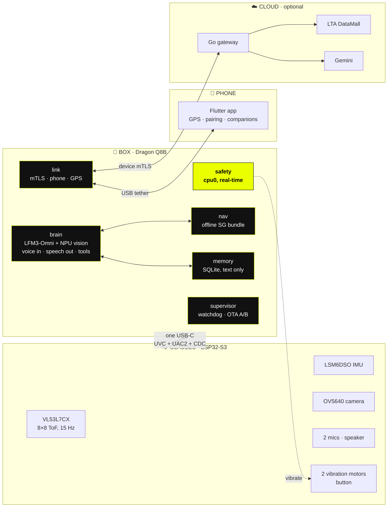
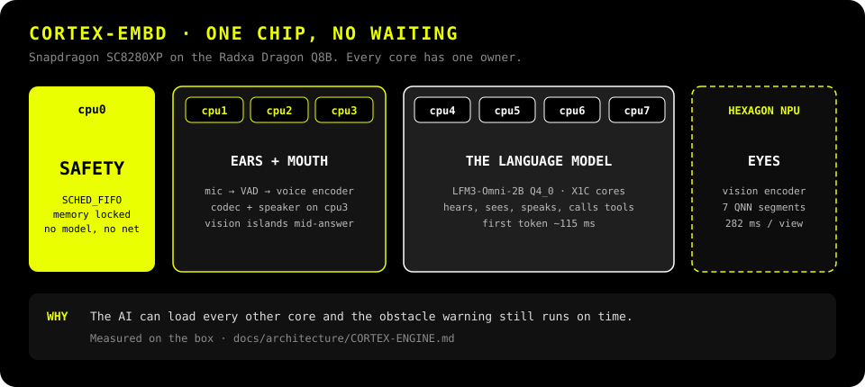
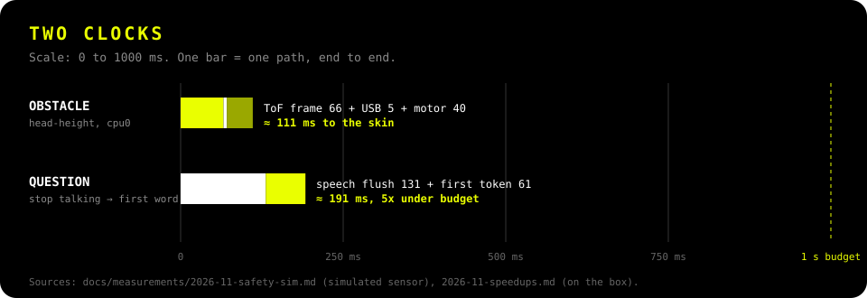
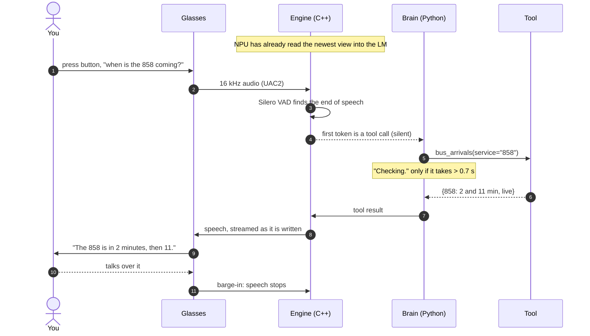
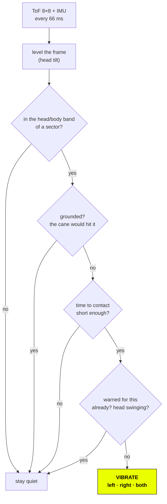
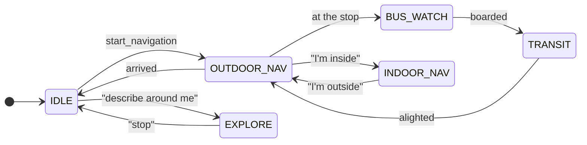
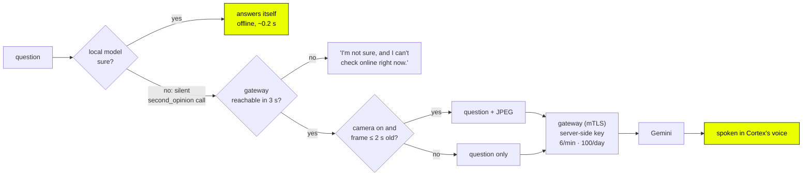
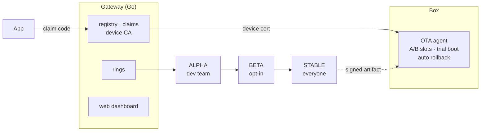

<div align="center">
  

  

  <br/>

  
  
  
  
  

  <br/><br/>

  <b>DOOR TO DOOR. ON YOUR OWN.</b><br/>
  <sub>Smart glasses and a pocket computer for blind and low-vision people in Singapore, used <i>with</i> the white cane, not instead of it.</sub>
</div>

<br/>


---

> [!NOTE]
> **This README describes V4**, a ground-up rebuild. V3 proved the idea and is now [archived](#v3-archived-).
> Every claim below is tagged with how real it is: **measured** on the box, **tested** on the dev server, or **designed**.
> Nothing is called done until it has run.

<table>
<tr>
<td><a href="#00-the-one-line-version">00 One line</a></td>
<td><a href="#01-the-shape-of-v4">01 Shape</a></td>
<td><a href="#02-one-chip-four-jobs">02 Chip</a></td>
<td><a href="#03-two-clocks">03 Clocks</a></td>
<td><a href="#04-a-question-from-mouth-to-ear">04 Question</a></td>
<td><a href="#05-the-cane-and-the-head">05 Safety</a></td>
</tr>
<tr>
<td><a href="#06-modes-who-decides">06 Modes</a></td>
<td><a href="#07-when-cortex-is-not-sure">07 Not sure</a></td>
<td><a href="#08-tools">08 Tools</a></td>
<td><a href="#09-the-ecosystem">09 Ecosystem</a></td>
<td><a href="#10-what-is-real-today">10 Status</a></td>
<td><a href="#11-repo-map">11 Repo</a></td>
</tr>
<tr>
<td><a href="#12-run-it">12 Run it</a></td>
<td><a href="#13-privacy">13 Privacy</a></td>
<td><a href="#v3-archived-">V3 archive</a></td>
<td colspan="3"><a href="#about">About</a></td>
</tr>
</table>

---

## 00 THE ONE-LINE VERSION

**V3 sent the world to the cloud and waited. V4 thinks on the device, answers in under a fifth of a second, and calls the cloud only when it is not sure.**

| | V3 (archived) | V4 |
|:---|:---|:---|
| Brain | Gemini Live in the cloud, five Python layers | **LFM3-Omni on the Snapdragon**: one model that hears, sees, speaks and calls tools |
| Offline | Degraded | **Full**: offline Singapore map, walking routes, buses, MRT |
| Safety | Mixed into the AI stack | **Its own process on its own core**, no model, no network |
| Vision | Frames streamed out | **Encoded on the NPU**, never leave the box unless you ask something it can't answer |
| Cloud | Required | **Optional**: live bus times and a Gemini second opinion, through our own gateway |
| Updates | Manual | Signed A/B OTA with rings and automatic rollback |

---

## 01 THE SHAPE OF V4

Three bodies, one rule: **anything that keeps you safe never depends on anything further right on this diagram.**



One process per failure domain. `brain` is deliberately **one** process (voice, vision, agent) so the path from your last word to Cortex's first word has no hand-offs. `safety` is deliberately **another**, so nothing the AI does can stall a warning.

---

## 02 ONE CHIP, FOUR JOBS



<sub><b>measured</b> on the box · vision encoder split into 7 NPU segments (QNN HTP, w8a16) + 6 CPU attention islands · answers match the CPU reference 12/12</sub>

---

## 03 TWO CLOCKS

Cortex runs on two clocks that never wait for each other.



| Path | Budget | Result | How real |
|:---|:---:|:---:|:---|
| You stop talking → first answer token | 400 ms | **~150 ms** median | measured, box |
| You stop talking → first word (after speedups) | 1 s | **191 ms** | measured, box |
| Question with the view ready → first token | 400 ms | **115 ms** | measured, box |
| Refresh what the camera sees | 1.4 s | 1.42 s (missed by 20 ms) | measured, box |
| Obstacle frame → vibration | — | ~111 ms (66 + 5 + 40) | simulated sensor |
| Route across Singapore | — | 68 ms median | measured, dev server |

---

## 04 A QUESTION, FROM MOUTH TO EAR



A tool call is **never spoken**. The model decides silently, so a wrong guess is never half-said before the right answer arrives.

---

## 05 THE CANE AND THE HEAD

> **The cane owns the ground. Cortex owns head-height and things that move in silence.**



Built from scratch for V4 (the V3 safety layer is not used) and tested against an independent simulator: 100 seeds × 26 scenes.

| Scene | Must | Passed |
|:---|:---:|:---:|
| Branch ahead · signboard · pipe at head height | warn | **100/100** |
| Low door header | warn | 99/100 |
| Wall, pole, standing person (the cane's job) | stay quiet | 94–98/100 |
| Branch in direct sunlight | warn | **70/100**, a known weakness |

<sub><b>simulated</b> · results and failure seeds in <code>docs/measurements/2026-11-safety-sim.md</code> · not yet tuned on the real sensor</sub>

---

## 06 MODES: WHO DECIDES

**Code owns the mode. The model may only ask.** A trip moves Cortex through modes automatically; how often it looks depends on where you are.



| Mode | Looks every | Speaks up about |
|:---|:---:|:---|
| IDLE | only when you talk | nothing |
| OUTDOOR_NAV | 2 s | turns, arrival |
| BUS_WATCH | 1 s | your bus coming, arrived |
| TRANSIT | off | next stop, get off now |
| INDOOR_NAV | 1 s | indoor cues |
| EXPLORE | 1 s | what is around, until told to stop |

---

## 07 WHEN CORTEX IS NOT SURE

The cloud is a **second opinion, not a crutch**. It is used only when *both* are true:



No API key ever lives on the glasses or the box. Frames and questions are passed through, never stored or logged. <sub><b>tested</b> end to end against a stand-in Gemini; not yet run against the real one.</sub>

---

## 08 TOOLS

One registry, [`contracts/tools/tools.json`](contracts/tools/tools.json), shared by the local model and the cloud.

```
 PLACES & ROUTES        TRANSIT                 CORTEX ITSELF
 ───────────────        ───────                 ─────────────
 search_places          nearby_bus_stops        set_mode
 plan_trip              services_at_stop        camera
 start_navigation       bus_arrivals            gps_accuracy
 stop_navigation                                search_memory   ← "where did I leave my keys?"
 nav_status                                     second_opinion  ← only when unsure
```

Each tool declares the modes it is allowed in and whether its result is spoken by a **template** (fixed sentence, instant) or by the **model** (phrased for you).

---

## 09 THE ECOSYSTEM



- **Shipped devices are updatable, never remotely breakable.** Signed artifacts, anti-rollback counter, a power cut at any write point leaves a bootable slot (tested).
- **The phone is a data pipe**: GPS, pairing, companion permissions. It never powers the box.

---

## 10 WHAT IS REAL TODAY

<table>
<tr><th>Part</th><th>State</th><th>Evidence</th></tr>
<tr><td>Engine (NPU vision + LFM3-Omni, voice in, speech out, tool calls)</td><td>🟢 measured on the box</td><td><code>docs/measurements/2026-11-engine-core.md</code></td></tr>
<tr><td>NPU vision encoder</td><td>🟢 measured on the box</td><td><code>2026-11-npu-vision.md</code></td></tr>
<tr><td>Offline Singapore nav bundle (walk, bus, MRT/LRT, 100k places)</td><td>🟢 measured on the dev server</td><td><code>2026-11-nav-bundle.md</code></td></tr>
<tr><td>Brain: modes, tool dispatch, nav cues</td><td>🟡 tested, scripted engine</td><td><code>core/tests/test_brain.py</code>, trips simulated end to end</td></tr>
<tr><td>Safety (ToF warner)</td><td>🟡 tested in simulation</td><td><code>2026-11-safety-sim.md</code></td></tr>
<tr><td>Memory ("where are my keys")</td><td>🟡 recalls; learning needs <code>ce_peek</code> on the box</td><td><code>core/tests/test_memory*.py</code></td></tr>
<tr><td>Gemini takeover, live bus arrivals</td><td>🟡 tested through the real gateway, stand-in upstreams</td><td><code>core/tests/test_gateway_session.py</code></td></tr>
<tr><td>Gateway, OTA, supervisor, phone link</td><td>🟡 tested, not on a real device</td><td><code>infra/AGENTS.md</code>, <code>core/AGENTS.md</code></td></tr>
<tr><td>Glasses firmware (UVC + UAC2 + CDC, haptics, fail-safe)</td><td>🟠 written, host-tested, not built on hardware</td><td><code>docs/architecture/GLASSES-USB.md</code></td></tr>
<tr><td>Tool choice by the real model</td><td>🟠 95 % on a stand-in, box run pending</td><td><code>2026-11-tool-eval.md</code></td></tr>
<tr><td>Detector cross-check (<code>check</code>), Gemini Live voice mode</td><td>⚪ not started</td><td></td></tr>
</table>

The honest, line-by-line version lives in [`core/AGENTS.md` §9](core/AGENTS.md).

---

## 11 REPO MAP

```
Asirive-Cortex/
├── core/                 V4 box runtime (Python + C++ engine)
│   ├── cortex_core/
│   │   ├── brain/        modes, tools, dispatcher, Gemini takeover
│   │   ├── engine/       native engine binding, camera/mic capture
│   │   ├── safety/       ToF warner (its own process)
│   │   ├── nav/          offline routing and trip following
│   │   ├── memory/       object memory
│   │   ├── link/         gateway mTLS, phone link, GPS
│   │   ├── ota/ supervisor/ tui/
│   ├── tools/cortex-engine/   libcortex_engine.so (llama.cpp + QNN)
│   └── AGENTS.md         rules + honest build status, read first
├── firmware/glasses/     ESP32-S3 firmware (ESP-IDF, TinyUSB)
├── infra/gateway/        Go fleet gateway, OTA signing, LTA + Gemini proxies
├── infra/navbundle/      builds the Singapore nav bundle from OSM + LTA
├── apps/mobile/          Flutter companion app
├── contracts/            protobuf, OpenAPI, the tool registry
├── docs/                 architecture/, superpowers/specs/, measurements/
└── v3_core/              🗄️ V3, archived and frozen
```

Every domain folder has an `AGENTS.md` that changes in the same commit as its code.

---

## 12 RUN IT

```bash
git clone https://github.com/Asirive/Asirive-Cortex.git && cd Asirive-Cortex

# box runtime tests (dev machine, no hardware)
python3 -m pytest core

# gateway
cd infra/gateway && go test ./... && cd -

# on the Dragon Q8B: build the engine, then talk to it with the real camera and mic
sh core/scripts/engine/box_build.sh
sh /opt/cortex/scripts/engine/live_tui.sh
```

Keys (LTA, Gemini) live only on the gateway, in `chmod 600` files named by `CORTEX_LTA_KEY_FILE` / `CORTEX_GEMINI_KEY_FILE`. Never in the repo, never on the device.

---

## 13 PRIVACY

| Data | Policy |
|:---|:---|
| Images and video | **Never stored**, on the box or on our servers. With the camera off, no frame leaves the box |
| Memory | Text only ("keys, black, on the table at home"), never pictures. GPS dropped after 30 days |
| Location | Shared per companion, only with your consent |
| Companions | Location and calls. No live camera feed, ever |

---

## V3 (ARCHIVED) 🗄️

<details>
<summary><b>V3, the proof (2025–2026)</b>: open to read what it was and what we kept</summary>

<br/>

<div align="center">
  
</div>

V3 was a Raspberry Pi prototype with a five-layer brain (L0 Guardian, L1 Learner with YOLO-World, L2 Thinker on Gemini Live, L3 Guide, L4 Memory), trialled with the Singapore Association for the Visually Handicapped and a finalist at the Tan Kah Kee Young Inventors' Award 2026.

**What V4 kept (ideas only):** a tool-based agent harness, and modes that set how proactive Cortex is.

**What V4 dropped:** the code, all of it. Several V3 layers only half worked, and V3 safety and memory are not used even as reference designs. `v3_core/` is frozen: bug fixes only, never imported by V4.

| V3 figure | Value |
|:---|:---|
| Intent routing accuracy | 97.7 % |
| Prototype BOM | ~USD 156 |
| Commercial alternatives | USD 2,500+ |

<sub>Measured on V3 hardware; not V4 numbers.</sub>

</details>

---

## ABOUT

Built by **Asirive**: Haziq Shah (lead engineering), Muhammad Irfan Nuafal and Eryna Natasha. Designed with and for the visually impaired community in Singapore.

*Asir* (Arabic: difficult) + *-ive*. Making the difficult navigable.

[asirive.com/cortex](https://www.asirive.com/cortex) · [github.com/Asirive](https://github.com/Asirive)

<div align="center">
  
</div>
