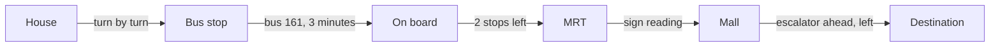
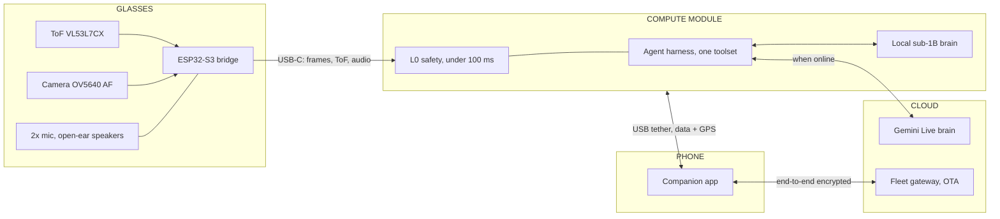
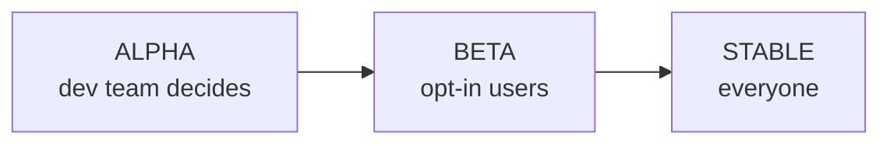

<div align="center">
  

  <br/>

  

  <br/>

  
  
  
  
  
  

  <br/>
  <br/>

  <b>DOOR TO DOOR. ON YOUR OWN.</b>
</div>


---

**CONTENTS**
[01 JOURNEY](#01-journey) | [02 SYSTEM](#02-system) | [03 SAFETY](#03-safety) | [04 VOICE](#04-voice) | [05 NAVIGATION](#05-navigation) | [06 HARDWARE](#06-hardware) | [07 APP](#07-app) | [08 INFRASTRUCTURE](#08-infrastructure) | [09 PRIVACY](#09-privacy) | [10 NUMBERS](#10-numbers) | [11 ROADMAP](#11-roadmap) | [12 REPO](#12-repo) | [13 SETUP](#13-setup) | [14 ABOUT](#14-about)

---

## 01 JOURNEY

One journey is the product: origin to destination, alone. Outdoor walking, indoor space, trains and buses.



---

## 02 SYSTEM

Five layers. Safety stays local. Reasoning can go to the cloud. The device never depends on the network to keep you safe.



| Layer | Name | Role | Where it runs |
|:---:|:---|:---|:---|
| **L0** | Guardian | Hazard detection, haptic and voice alerts | Device, offline, **under 100 ms** |
| **L1** | Learner | Open-vocabulary detection (YOLO-World on NPU) | Device |
| **L2** | Thinker | Scene understanding, conversation, function calling | Gemini Live and local sub-1B model |
| **L3** | Guide | Intent routing, navigation, transit, indoor guidance | Device with phone relay |
| **L4** | Memory | Recall, history, telemetry | Local first, retention-aware sync |

One agent toolset. Two interchangeable brains. Connected, Gemini leads on malls, interchanges and signage. Offline, the local model keeps you moving.

---

## 03 SAFETY

> **The cane handles the ground. Cortex handles head-height and beyond.**

| Hazard | Cane covers | Cortex alerts |
|:---|:---:|:---:|
| Walls, benches, curbs, stairs down | Yes | No, indoors |
| Overhead obstacles, signs, branches | No | Yes |
| Stairs going up | No | Yes |
| Fast-approaching vehicles and e-scooters | No | Yes |
| Text, bus numbers, prices, faces | No | Yes |

Alerts are hard-coded and model-independent. No AI sits between a hazard and its warning. They fire with no phone, no cloud and no internet.

---

## 04 VOICE

- Microphones and open-ear speakers built into the glasses. Ears stay open for traffic.
- Wake word "Hey Cortex". A voice command mutes the mic, confirmed by haptic.
- Two voices: conversation and safety never sound alike, so a warning is recognized before it is parsed.
- Cloud voices when connected, local speech synthesis offline. Speak over Cortex and it stops talking.

---

## 05 NAVIGATION

| Mode | Trigger | Behavior |
|:---|:---|:---|
| IDLE | Default | Silent unless a hazard fires |
| OUTDOOR_NAV | GPS fix, active route | Turn by turn, reads landmarks and signs |
| INDOOR_NAV | GPS lost | Visual guidance: "door left", "escalator ahead" |
| BUS_STOP | Near a stop | LTA arrivals, on-device bus number reading |
| TRANSIT | On bus or MRT | Stop counting, overhead sign reading |

Fourteen agent functions: search_places, get_directions, guide_indoor, get_bus_arrival, zoom_in, search_memory, report_obstacle. Multi-leg routes supported.

---

## 06 HARDWARE

### Glasses

| Part | Role |
|:---|:---|
| **VL53L7CX** 8x8 ToF, 90 degree field of view, 3.5 m | Overhead and ground hazard ranging |
| **OV5640** 5 MP 120 degree autofocus camera | Scene stream, close-up reading of signs and prices |
| **ESP32-S3** N16R8 | I/O bridge: camera, ToF and audio over one USB-C |
| 2x **MP34DT01** PDM MEMS microphones | Voice and ambient capture |
| **MAX98357A** amp, 2x **1511** open-ear speakers | Voice output without blocking hearing |
| Haptic motor | Microphone state, device status |

Rules: no folding frame (the ribbon must never flex at a hinge). Sensors stay on the brow line. The lower visual field stays clear, because partially-sighted users keep their remaining sight.

### Compute module

| | Alpha | V4 Final |
|:---|:---|:---|
| Board | Radxa Dragon Q8B | Custom SoM, custom carrier |
| Silicon | Snapdragon 8cx Gen 3, 29+ TOPS AI Engine | Smaller, faster, production |
| Memory | 8 GB, quantized sub-1B models | TBD |
| Power | Own battery, pogo-pin dock | TBD |

The phone is a data pipe only. It never powers the device.

---

## 07 APP

One Flutter application (iOS first, Android in scope). Two modes.

**User mode.** Pair the device, settings, beta opt-in, feedback, and per-companion permission grants to friends, family or certified medical professionals.

**Companion mode.** See the user's location and make a voice call. No live camera feed. No stored photos or video.

---

## 08 INFRASTRUCTURE



- **Go fleet gateway.** Device registry, end-to-end encrypted channels. Shipped devices are provisionable and updatable, never remotely breakable.
- **OTA with rings.** Signed artifacts, staged rollout, rollback. Updates reach the compute module and the glasses MCU through the app.
- **Web dashboard.** Fleet, rings, feedback tab. Feedback from every ring lands here.

---

## 09 PRIVACY

| Data | Policy |
|:---|:---|
| Images and video | Never stored. Zero retention, including on our own infrastructure |
| Location | Retained 30 days, shared per companion with your consent |
| Calls, transit data, activity logs | Stored |
| Companion access | Location and calls only. No live feed, ever |

---

## 10 NUMBERS

<div align="center">
  
  
  
  
  
</div>

Measured on V3 hardware. Community trials with the Singapore Association for the Visually Handicapped.

---

## 11 ROADMAP

<div align="center">
  
  
  
  
</div>

| Stage | Scope |
|:---|:---|
| **V3, the proof** | Raspberry Pi prototype, five-layer brain, cane-aware safety, community trials. YIA 2026 finalist |
| **V4 Alpha, the ecosystem** | Custom glasses, Dragon Q8B, companion app, Go infrastructure. Lab first, field tested once lab-proven |
| **V4 Final, the product** | Custom SoM and carrier board. Manufacturing through the NTU partnership. Grant funded |
| **Horizon** | In-house sub-1B non-transformer scene model, run locally, accurate enough to lead |

---

## 12 REPO

```
ProjectCortex/
├── core/           The five-layer brain, being refactored for V4
│   └── device/     Cameras, sensors, GPS, power
├── infra/          Protocol seeds, Go fleet gateway lives here
├── apps/           Device CLI and companion surfaces
├── docs/           architecture/V4-ECOSYSTEM.md, start here
└── miscellaneous/  Models, media, archive, tools, tests, legacy deploy
```

Deprecated V2 and V3 systems still ship in this repository while they are refactored out. Each of core/, infra/ and apps/ carries an AGENTS.md that must be updated with every change in that domain.

---

## 13 SETUP

```bash
git clone https://github.com/Asirive/Asirive-Cortex.git
cd Asirive-Cortex
python -m venv venv && source venv/bin/activate
pip install -r requirements.txt

# Full system with Textual TUI
python -m apps.cortex all

# Subsystem checks
python -m apps.cortex test-live    # minimal Gemini Live probe
python -m apps.cortex status       # env, config, layer availability
```

`.env` (gitignored): GEMINI_API_KEY, GOOGLE_MAPS_API_KEY, LTA_API_KEY, CARTESIA_API_KEY, SUPABASE_URL, SUPABASE_KEY. Key-rotation pool supported.

---

## 14 ABOUT

<div align="center">
  
</div>

Asirive Cortex is built by **Asirive**: Haziq Shah (lead engineering), Muhammad Irfan Nuafal and Eryna Natasha. Finalists at the Tan Kah Kee Young Inventors' Award 2026. Designed with and for the visually impaired community in Singapore.

*Asir* (Arabic: difficult) plus *-ive*. Making the difficult navigable.

[asirive.com/cortex](https://www.asirive.com/cortex) | [github.com/Asirive](https://github.com/Asirive)

---

<div align="center">
  

  <br/>

  
</div>
